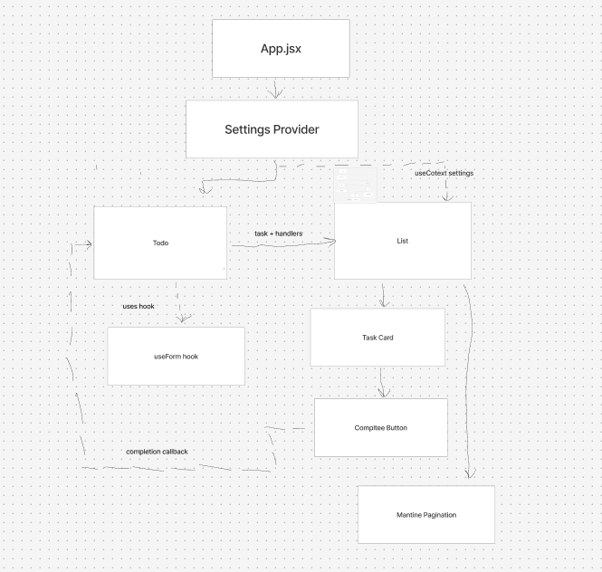

# Todo App

A React task management application built with Vite, Mantine UI, and React Context.

## UML Diagram

The diagram below illustrates the component structure, shared settings, task management, and completion callbacks.

## React Context API

The Todo App uses React Context to share application settings
with components without passing settings through multiple
levels of props.

SettingsContext.jsx provides three default settings:

- itemsPerPage: 3
- hideCompleted: true
- sortWord: difficulty

The List component uses useContext(SettingsContext) to
access these settings.

It displays three incomplete tasks per page, hides
completed tasks, and sorts tasks by difficulty.

Mantine Pagination allows users to navigate additional
pages when more than three incomplete tasks exist.

## useForm Custom Hook

The useForm hook manages the Todo form's input values.

- useState stores the form values.
- handleChange updates values when the user enters information.
- handleSubmit prevents the default form submission and
  passes the collected values to the addItem callback.
- useEffect initializes form values from defaultValues.

This keeps form-handling logic separate from the Todo
component.

## Testing

Testing uses Vitest and React Testing Library.

Two automated tests currently verify:
- The Todo component renders its header.
- The Settings Provider supplies the required default values.

Completed-task filtering, pagination, and difficulty
sorting were also verified manually in the browser.

Production build verified using npm run build.

## AI Assistance

ChatGPT was used as a coding assistant during Lab 31.

Example prompts:
- "Help me implement React Context settings for my Todo App."
- "Help me test the default Context settings using React Testing Library."
- "Explain what npm run build does."

AI assistance included reviewing component relationships,
debugging, explaining React concepts, and helping create
a Context settings test.

The application was tested and verified locally.

## CodeSandbox

[View Todo App in CodeSandbox](https://codesandbox.io/p/sandbox/jg3dkz)

[View Live Todo App](https://jg3dkz.csb.app/)

## Global State Management

This application uses the React Context API to share settings
between components without passing them through props.

The SettingsProvider manages three default settings:

- itemsPerPage: 3
- hideCompleted: true
- sortWord: difficulty

The List component uses useContext(SettingsContext) to access
these settings.

The settings control pagination, hide completed tasks,
and sort tasks by difficulty.

## Custom useForm Hook

The application uses a custom `useForm` hook located in `src/hooks/form.js`.

The hook manages form input values and handles form submissions.

- `useState` stores the current form values.
- `handleChange` updates values when a user enters information or adjusts the difficulty slider.
- `handleSubmit` prevents the browser from refreshing and passes the form data to the `addItem` function.
- `useEffect` initializes the form with default values.

The Todo component uses this hook to collect task details and add new tasks to the list.